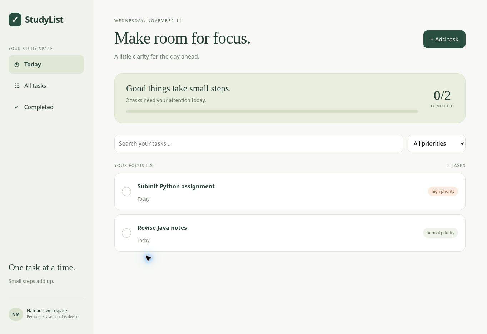
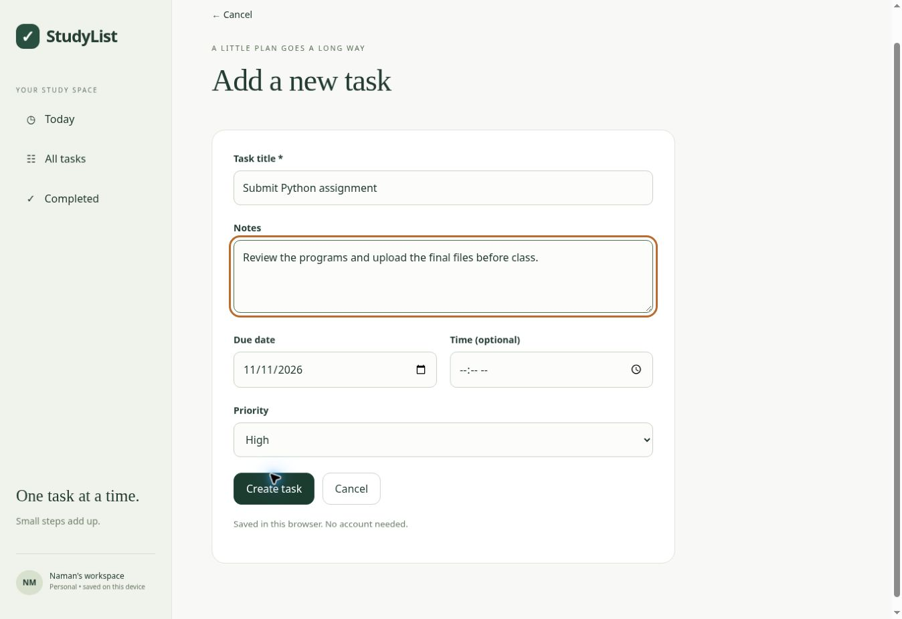
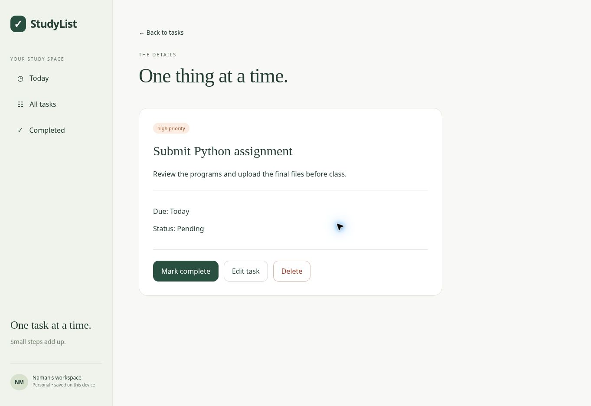
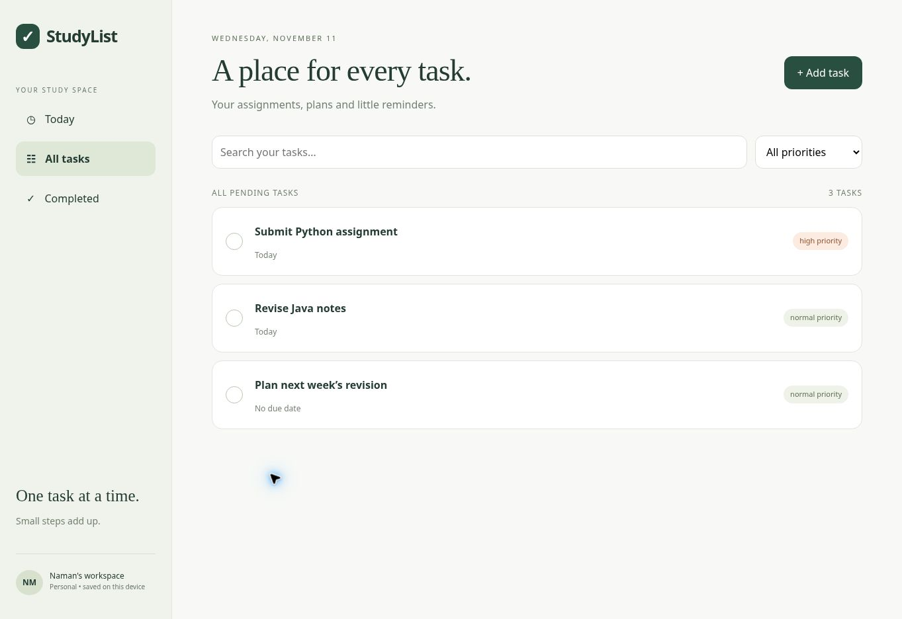
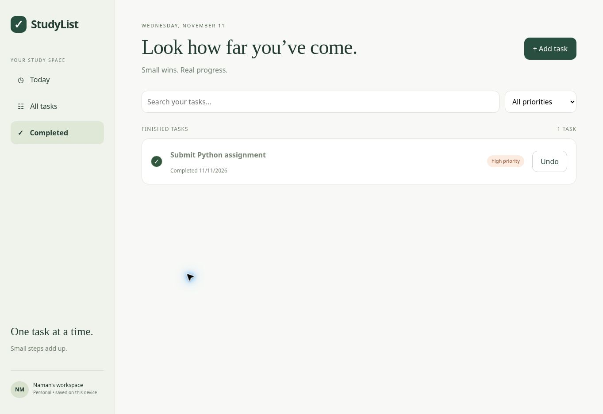
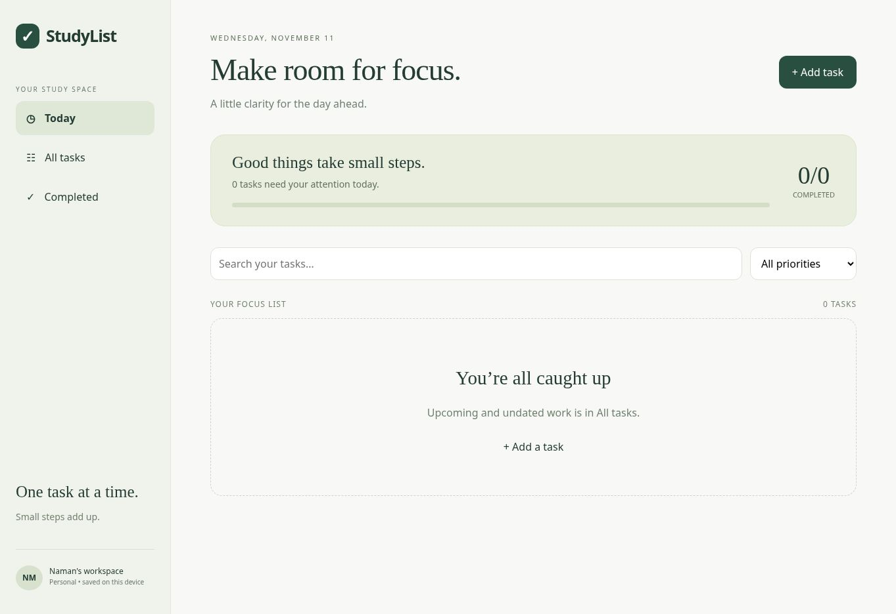
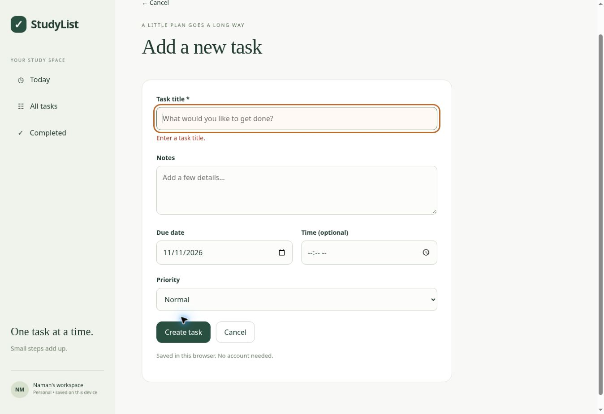
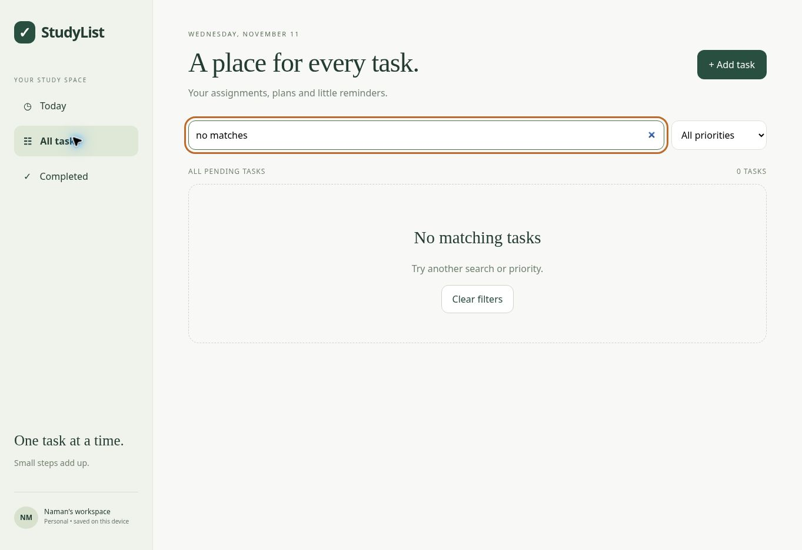
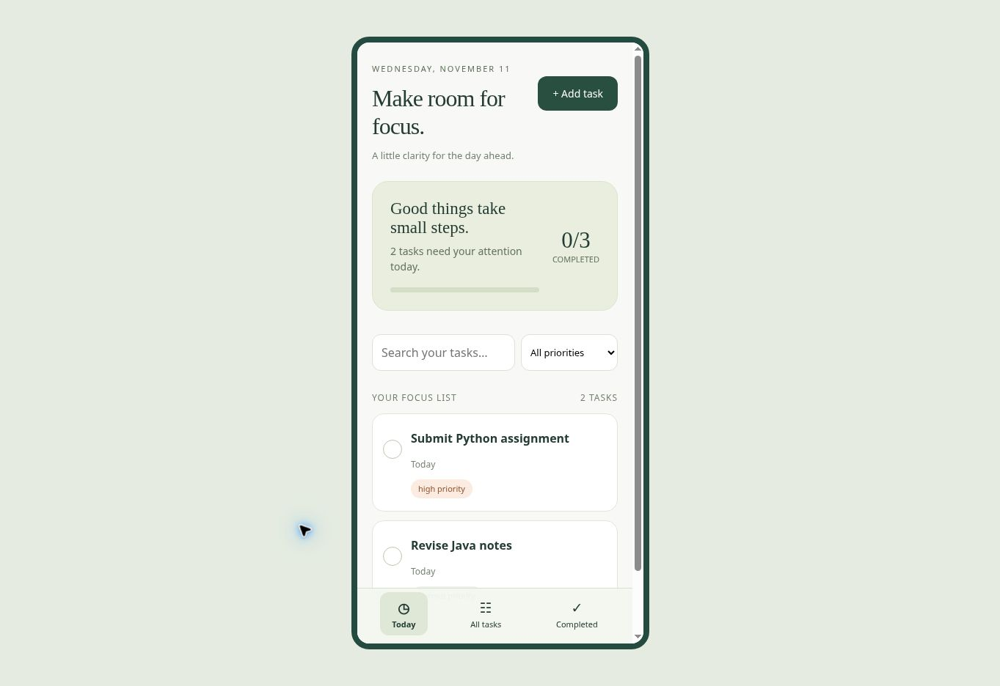

# StudyList — Final App Project

A student task planner for assignments, revision and personal reminders. Built with **HTML, CSS and vanilla JavaScript** as a mobile-responsive web app. No React Native, Flutter, database, account or API keys are required.

**Author:** Naman Meena · BCA  
**Task 4:** polished application, real screenshots, setup instructions and a short demo note.



## Quick start

Download **Code → Download ZIP** and extract it, or clone this repository:

```sh
git clone https://github.com/meenanaman326-gif/naman.git
cd naman
python3 -m http.server 8000
```

Open **http://localhost:8000** in a modern browser. On Windows, use `py -m http.server 8000` if `python3` is unavailable. Keep the terminal running; Ctrl+C stops it. A blank task list on first launch is expected.

See [SETUP.md](SETUP.md) for prerequisites, ZIP instructions and troubleshooting. See [DEMO.md](DEMO.md) for a one-minute walkthrough.

## Complete features

- Create and edit tasks with title, notes, optional date/time and priority.
- Today shows tasks due today or overdue; All tasks includes future and undated tasks.
- Mark complete, review finished tasks, or restore them with Undo.
- Delete through a confirmation dialog; Keep task cancels the deletion.
- Search titles and filter by priority; Clear filters restores an empty search result.
- Validation for blank/long titles, long notes, actual dates, 24-hour time and priority.
- LocalStorage persistence across reloads; failed saves preserve memory and form entries.
- Damaged stored data is not overwritten; a stale tab is asked to reload before saving.
- Mobile navigation, visible priority labels, keyboard focus, labelled inputs and status feedback.

## Screenshots

Actual Chromium captures from 11 November 2026. The demonstration tasks were entered through the app and are **not** seeded for new users.

| Screen | Preview |
| --- | --- |
| Add task |  |
| Task details |  |
| All tasks |  |
| Completed |  |
| Fresh empty state |  |
| Validation |  |
| Empty search |  |
| Phone layout |  |

The phone view was captured in a narrow browser iframe. It demonstrates the responsive web layout, not a native Android/iOS package or a real-device certification.

## Project files

| File | Purpose |
| --- | --- |
| `index.html` | App shell, navigation and delete dialog |
| `styles.css` | Desktop and phone layout, focus and validation styles |
| `app.js` | Routes, forms, task actions, list rendering and persistence |
| `task-state.js` | Pure input and stored-record validation |
| `test-state.cjs` | Automated tests using Node's built-in test runner |
| `docs/screenshots/` | Real application screenshots |
| `SETUP.md` | Local setup and troubleshooting |
| `DEMO.md` | Short demonstration note |
| `docs/QA.md` | Checks and verification limits |
| `TASK3.md`, `TASK4.md` | Assignment requirement mapping |

## Tests

Node.js 18+ is required **only for tests**, not to run the app:

```sh
node --check app.js
node --check task-state.js
node --test test-state.cjs
```

**12 tests pass.** They cover valid/invalid inputs, leap dates, persistence, complete/restore, deletion state, storage failures, damaged data protection, stale-tab protection, malformed routes and form submission behavior. Browser checks cover creation, editing, completion/Undo, validation correction, no-match search, undated task visibility, persistence and phone layout.

## Scope and limitations

This is a locally runnable student project. Data belongs to the current browser/profile/origin; it is not uploaded or synchronized. Clearing site data removes saved tasks. Open tabs are not live-synchronized; reload a stale tab before editing. LocalStorage does not provide an atomic multi-user database. There are no notifications, authentication, export/import or cloud backup. Date/time input appearance varies by browser. The complete test record and accessibility limitations are in [docs/QA.md](docs/QA.md).

## Submission

Copy this exact repository URL, with no spaces:

https://github.com/meenanaman326-gif/naman

Publish the Task 4 video on LinkedIn and submit the resulting **post URL** in the separate LinkedIn field.
